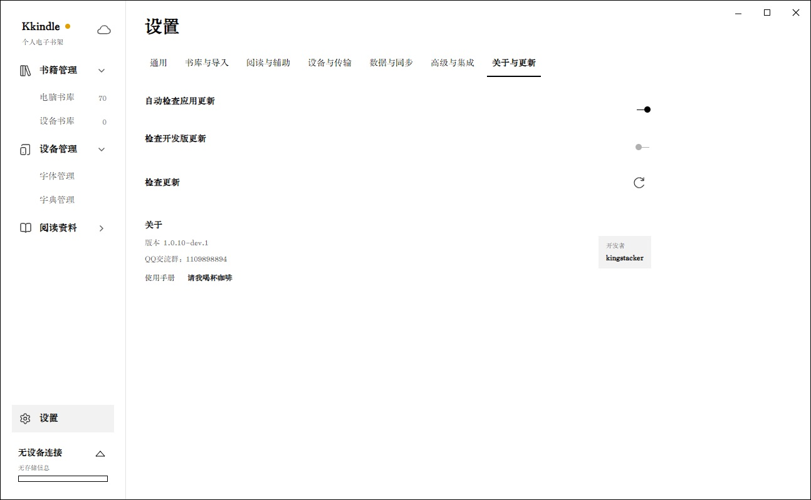
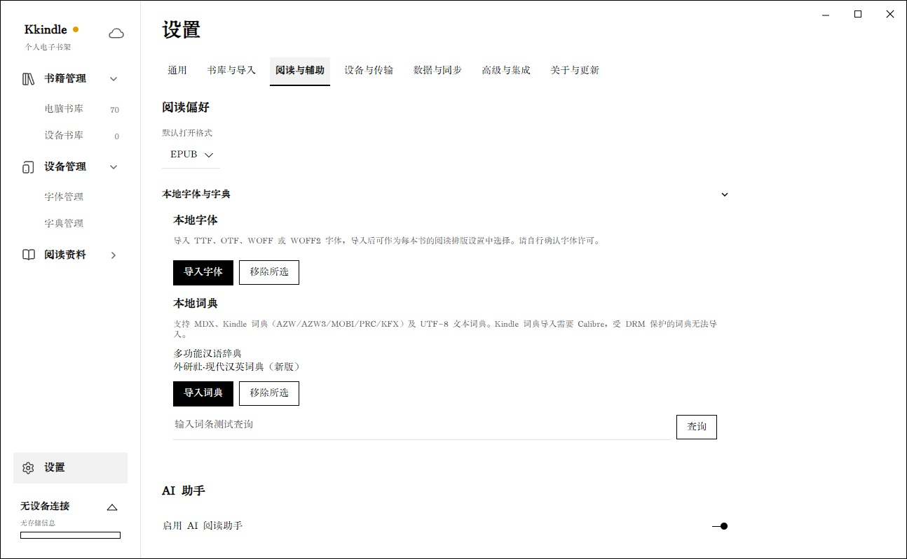

# 设置、更新与本地词典

主窗口左下角的“设置”打开设置页。点击页面顶部的类别名称进入对应设置。大多数选项会自动保存；“数据与同步”中的服务配置需要点击页面下方的“保存设置”。改完同步配置后，可以先点“测试连接”，确认连接成功，再点“保存设置”。

## 设置类别

- **通用**：界面语言、主题、启动行为和网络功能。关闭网络功能后，在线更新、百科、AI 等需要联网的功能不可用。
- **书库与导入**：默认打开格式、书库显示、Calibre 和 `ebook-convert` 路径等。
- **阅读与辅助**：阅读格式、字体与字典、AI、翻译和辅助阅读功能。
- **设备与传输**：Kindle 连接、Send to Kindle、邮件发送和设备相关选项。
- **数据与同步**：备份、恢复、回收站、自动备份、S3 和 WebDAV。
- **高级与集成**：平台诊断、软件日志导出和 MCP 等集成；不使用外部 AI 客户端时，可跳过 MCP 配置。
- **关于与更新**：当前版本、更新渠道、手动检查更新和联系信息。

## 检查应用更新

打开“设置 → 关于与更新”。“自动检查应用更新”控制启动后的自动查询；“检查开发版更新”关闭时查询稳定版，开启时查询开发版。渠道选择同时影响自动检查和手动检查。

需要立即检查时，点击“检查更新”行最右侧的刷新按钮。自动检查只查询版本，不会在后台安装更新。Kkindle 会在完成首次设置、允许联网且开启自动检查时，于启动后约 3 秒查询；当天已有成功查询时不会重复自动检查。关闭自动检查不影响手动检查。

手动查询前请确认“通用”中的网络功能已开启。发现新版本后，支持应用内更新的平台会下载更新包，并在下载完成后提示退出安装；暂不支持应用内安装的平台会在确认后打开版本下载页面。若提示当前版本已是最新版本，则无需操作。检查失败时，请确认网络和更新渠道后再试。

## 导入和使用本地词典

1. 打开“设置 → 阅读与辅助”，展开“本地字体与字典”。
2. 在“本地词典”区域点击“导入词典”，选择一个词典文件并等待导入完成。成功后，词典名称会显示在列表中。
3. 可在下方的“输入词条测试查询”框输入词语，点击“查询”确认词典能返回释义。
4. 阅读时选中词语并点击“查词”，即可查看本地释义。若列表中有不再使用的词典，先选中它，再点“移除所选”。

支持 MDX、Kindle 词典（AZW、AZW3、MOBI、PRC、KFX）以及 UTF-8 TXT、TSV 和 CSV 词典。导入 Kindle 词典需要安装 Calibre；受 DRM 保护的词典无法导入。词条查不到时，可先在设置页用相同词语测试，并确认读者的查词结果中有本地词典释义。

## 主题和阅读排版

“通用”中的主题用于主界面；阅读器主题、字号、行距、正文宽度、字体和竖排等选项位于“阅读与辅助”。调整后可打开一本书查看效果。排版选项作为全局设置应用到书籍；字体文件需要先在“本地字体与字典”中导入。

## 平台诊断与导出日志

1. 打开“设置 → 高级与集成”，展开平台诊断区域。
2. 查看项目状态和说明。诊断会检查数据目录、阅读器、PDF、Calibre、TTS 和 Kindle 等能力；如果项目旁提供修复按钮，可以先尝试修复，再重新检查。
3. 如需提交问题信息，在同一类别使用“导出软件日志”并选择 ZIP 保存位置。

反馈问题时请附上 Kkindle 版本、操作系统和复现步骤。分享日志或截图前，先检查其中是否包含个人路径、账号信息或其他不想公开的内容。
