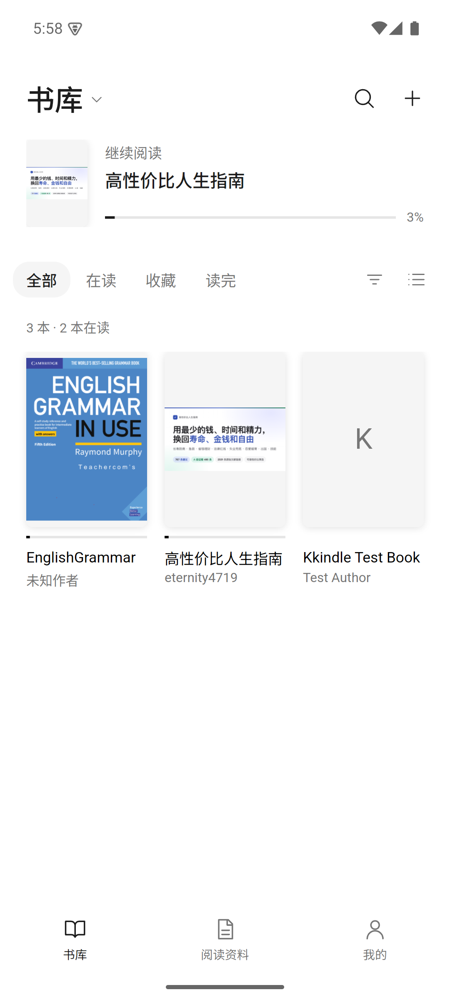
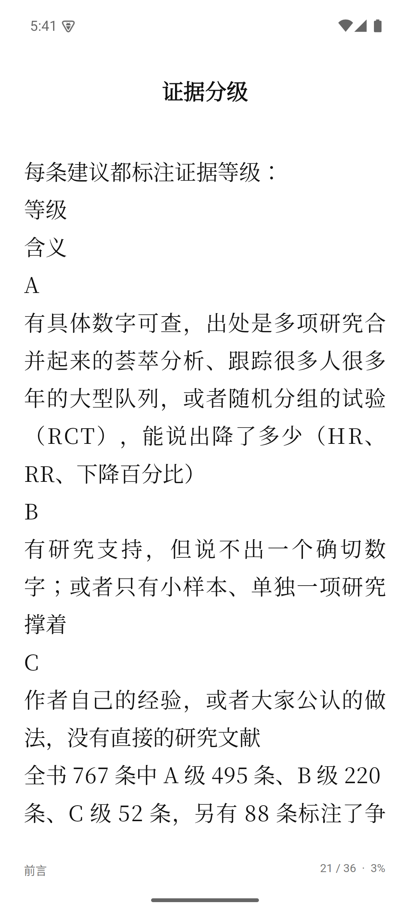
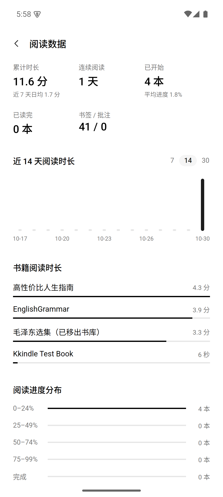
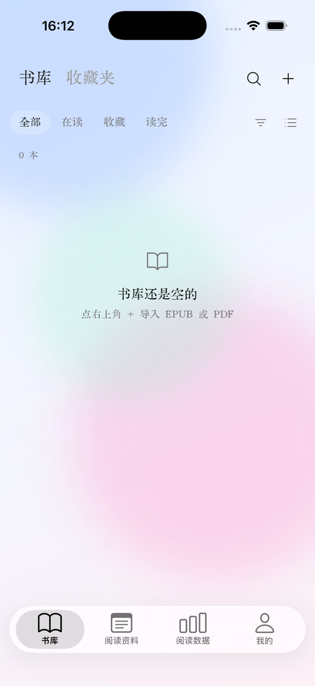

# Mobile app (Android + iOS)

The mobile head is a separate solution so the desktop release pipeline keeps
building and testing without the mobile workloads installed.

```
Kkindle.sln                 desktop only: Core / Infrastructure / Application / App / Desktop heads
Kkindle.Mobile.sln          mobile: Kkindle.Mobile + Kkindle.Mobile.Android + Kkindle.Mobile.iOS + Kkindle.Mobile.Desktop
```

## Projects

| Project | TFM | Purpose |
| --- | --- | --- |
| `src/Kkindle.Mobile` | `net10.0` | Platform-neutral single-view shell, pages and mobile styles. No Android/iOS APIs. |
| `src/Kkindle.Mobile.Android` | `net10.0-android36.0` | Android head: `AvaloniaMainActivity`, private data root, secret storage, document-provider import. |
| `src/Kkindle.Mobile.iOS` | `net10.0-ios` | iOS head: `AvaloniaAppDelegate`, sandbox data root, secret storage, document picker. |
| `src/Kkindle.Mobile.Desktop` | `net10.0` | Dev-only preview harness that shows the phone shell in an 411x880 window. |

`Kkindle.Mobile` references Core, Application, Infrastructure and Layout, so the
same library, reader-data and metadata services the desktop shell uses are
available unchanged.

## Screens

Captured on the `Kkindle_Pixel` emulator:

| 书库 | 书籍详情 | 阅读页 |
| --- | --- | --- |
|  |  |  |

| 阅读资料 | 我的 |
| --- | --- |
|  |  |

Captured on the iPhone 17 Pro simulator (iOS 26.5, Liquid Glass theme):

| 书库 |
| --- |
|  |

## Design system

The phone UI is quiet and neutral: hierarchy comes from spacing, the system sans
at regular and medium weights, and soft gray. Solid black or white blocks are
never used for emphasis, so the main action is a soft tint and selection is a
small pill or a raised segment. Book covers keep their own color unless 我的 →
黑白封面 is on; the bundled Song face is for reading text only.

- `Styles/MobileTokens.axaml`: light and dark tokens. Add colors here, never in
  a view.
- `Styles/MobileIcons.axaml` + `Controls/LineIcon`: the 24×24 icon set.
- `Styles/MobileTheme.axaml`: type scale and the button, chip, segment, row,
  cover and floating-card classes.
- Reader paper is 白 / 米 / 黑. 黑 is `ReaderTheme.Ink`, added to the shared enum
  and `ReaderPalette`; the desktop theme picker does not offer it yet.
- `MobilePreferencesStore` holds phone-only choices in
  `mobile-preferences.json`; library data stays in the database.

## iOS head

`Kkindle.Mobile.iOS` mirrors the Android head: `Main` publishes `MobileServices`
before UIKit starts, `AppDelegate` hosts `MobileApp`, `IOSSecretProtector` keeps
its key inside the app sandbox, and `IOSFileImportSource` copies documents
picked through the system picker into the cache. `IOSGlassTabBar` supplies the
native bar described below.

On iOS 26 `IOSGlassTabBar` hosts a native `UITabBar`, so UIKit controls its
Liquid Glass material, selection, and accessibility. Segmented groups are
hosted by `IOSNativeSegmentControl` for the same reason (see below). The shared shell reserves
space for it and hides it while a page or bottom sheet is open. Content uses a
neutral background and the system UI font; book text keeps its reader font.
On iOS 15–25 the shared Avalonia tab bar is used.

Intel Macs can only run Xcode 26, while the current .NET iOS workload targets
Xcode 27. The head therefore pins `ValidateXcodeVersion=false` and
`MtouchLink=SdkOnly`, which keeps the app building without iOS 27-only APIs.

```
dotnet build src/Kkindle.Mobile.iOS/Kkindle.Mobile.iOS.csproj -c Debug \
  -f net10.0-ios -p:RuntimeIdentifier=iossimulator-x64
xcrun simctl boot "iPhone 17 Pro"
open /Applications/Xcode.app/Contents/Developer/Applications/Simulator.app
xcrun simctl install booted src/Kkindle.Mobile.iOS/bin/Debug/net10.0-ios/iossimulator-x64/Kkindle.Mobile.iOS.app
xcrun simctl launch booted com.kingstacker.kkindle
```

iOS reads aloud through `AVSpeechSynthesizer` (rendered to WAV like the Android
adapter) and plays it with `AVAudioPlayer`; system-bar tinting is not wired yet.
The reader hides its listening button when a host has no TTS engine and player.

## What is wired up

- `MobileApp` builds `ApplicationModules` from `MobileServices` (paths, secret
  protector, metadata service, format converter, import source) supplied by the
  platform head before Avalonia starts.
- `MobileShell` owns three tab roots (书库 / 阅读资料 / 我的), a push stack for
  书籍详情 and 阅读页, one shared bottom sheet and a toast. Android's back gesture
  is routed through `TopLevel.BackRequested`: it closes the sheet, then pops the
  stack, before the activity leaves the app.
- `LibraryPage` has two views under the 书库 / 收藏夹 masthead. 书库 has search,
  filters, sorting, grid and list views, a 继续阅读 row and import.
  `CoverCache` decodes covers off the UI thread.
- 收藏夹 shows each collection as a card fronted by `CoverStack`, a fan of its
  three newest covers (empty slots are drawn as faint ghosts). Long press, or
  ⋯ on `CollectionPage`, offers the desktop's actions: rename, clear, merge into
  another collection, and dissolve. `CollectionPage` adds books several at a
  time through `BookPickSheet` and removes one on long press. The automatic
  “未收藏” collection appears last, only while it holds books, and cannot be
  edited. `MobileCollections` holds the shared actions.
- `BookDetailPage` shows metadata and progress, and handles favorite, 加入收藏夹,
  rename, delete and sending to Kindle. `BookEditPage` edits the same fields as
  the desktop detail pane. In developer mode, 从豆瓣获取 searches Douban (with
  covers), lets the reader pick which fields to take, fills the form, and
  writes only on save.
- Developer mode: tap 我的 → 版本 five times (again to leave). As on desktop,
  where clicking the version five times does the same, it lasts for the current
  run and holds features outside the normal product: Douban lookup and
  Z-Library (on desktop also automatic Douban matching on import).
- `ZLibraryPage` searches Z-Library (format filter, covers, paging) and
  `ZLibraryDownloader` downloads into the library like the desktop app: import
  the file, then write the page's details (title, author, publisher, year,
  series, edition, ISBN, pages, language, description, cover) with
  `ZLibraryMetadata.Apply`. Books already in the library are not downloaded
  again. The account shares the desktop's protected settings file.
- `NativeSegmentGroup` hosts UIKit's segmented control, which is a platform
  view drawn above the whole Avalonia scene and therefore cannot be clipped by
  a scrolling page or covered by a sheet. Whenever any part of it leaves the
  visible viewport, or the sheet panel physically covers it, it hands over to
  the Avalonia fallback, which is clipped and still takes taps. A sheet that
  does not cover it dims it in place through `IOSNativeSegmentControl`, whose
  scrim follows the page's sheet scrim so the control keeps its own appearance
  and only darkens with everything else. Coverage is only trusted after the
  sheet has been laid out, so a control cannot stay on top of the panel.
- `ReaderPage` is paginated. The chrome stays hidden while reading, but the
  system bars stay visible and take the paper color: hiding them reflows the
  page on every toggle and raises Android's full-screen confirmation. Side taps
  and swipes turn pages, a center tap toggles the chrome, and a long press hands
  the following drag to the host as a text selection for highlights, notes and
  copying. Gestures are classified in tunnel handlers so the shared hosts stay
  unchanged. Links, footnotes and PDF zoom (a zoomed page pans under the finger)
  are supported, for EPUB and PDF alike, plus whole-book search, reading aloud
  with a choice of system voice and speed, local dictionary lookup, an AI
  assistant, and translation (AI when configured, otherwise Bing). The assistant
  searches local book text by keyword when answering book questions; page
  summaries and selection explanations use the current page. Pinches are
  recognized in the reader's own tunnel handlers because the PDF surface takes each finger. The
  排版 sheet adjusts font size, line spacing, side margins and first-line
  indentation (首行缩进), and switches between horizontal and vertical (竖排)
  typesetting; vertical books are laid out single-page. Phone margins run from
  16 to 36 points, below the desktop's 24-point floor.
- Progress, bookmarks and annotations store chapters relative to the book, like
  the desktop app, because the rows sync between devices.
- `MaterialsPage` groups bookmarks, highlights and notes by book, opens the
  reader at the tapped location and exports the selected category as Markdown or
  plain text through the system file picker or share sheet.
- 我的 → 回收站 lists deleted books and formats, with restore and confirmed
  permanent deletion.
- `ReadingDataPage` is the desktop reading dashboard laid out for a phone:
  totals, stat cards, a tappable daily chart, recent and most-read books with
  covers, a stacked progress bar and medals with progress rings.
  `ReadingMedalCatalog` in Core is the one definition of medals and streaks.
- `SyncSettingsPage` edits the settings file the desktop app uses. Its connection
  parameter files are compatible with desktop S3 and WebDAV profiles: import
  fills a draft that must be saved, while export uses the current draft. The file
  contains the selected provider's credentials in plain text but excludes the
  sync encryption key. `MobileSync` is the single path for manual and automatic
  runs. Automatic sync runs on launch, when returning to the foreground and after
  leaving the reader.
  Large deletions need confirmation on the sync page and background runs never
  approve them; smaller deletions sync directly, as on desktop. Synced books
  arrive as metadata and their files download when first opened.
- `AiSettingsPage` and `KindleSettingsPage` edit the desktop-compatible protected
  AI and Kindle e-mail settings. On Android, `BackgroundSyncJob` requests periodic
  sync while the app is closed; the system decides when it runs. iOS has no
  equivalent periodic background sync.
- The Android head uses .NET's managed HTTP handler (`UseNativeHttpHandler`
  false) because Android's own stack rejects WebDAV `PROPFIND`, and allows
  cleartext HTTP so self-hosted servers on the local network work.
- In the reader, edge drags are excluded from Android's back gesture so a
  selection starting at the margin does not leave the book.
- `AndroidSecretProtector` seals its key with the Android Keystore and migrates
  the plain key file older builds wrote.
- Reader tables are created lazily by `MobileShell.EnsureReaderDataAsync()`
  because the mobile shell has no startup phase that runs the schema pass the
  desktop `MainWindow` performs.

## Library backup and restore

In 我的, export a `.kkindle` backup through the system save or share interface,
then keep the file somewhere outside the app. While a backup runs, the shell
covers the app with a blocker that follows `AppBackupProgress`: a progress bar
and the current step, so a large library does not look stuck. Restore selects one backup, asks
for confirmation and replaces the current library. A successful restore blocks
further use and sync until the app process is restarted: fully close the app
(including dismissing it from the app switcher), then open it again. On iOS,
simply moving the app to the background does not restart it.

The package uses the same format as the desktop backup service and includes the
library database, book files, book covers, reading-material covers, trash, and
supported non-secret AI, Kindle email and sync settings. Mobile-only preferences
are not included. Earlier desktop backups did not include reading-material covers;
when such a backup is restored, existing covers in the destination are retained,
but missing covers cannot be recovered from that backup. An older app version may
not restore reading-material covers contained in a newer backup.

API keys, SMTP passwords, sync credentials and sync encryption keys are not
exported. Restore retains secrets already on the destination device; they may
need to be entered again or checked against the restored service settings.
Sync can be disabled when required credentials or the encryption key are absent.

## What is not there yet

- Kindle device management over USB and MOBI/AZW3 *conversion*, which rely on
  desktop-only USB access and Calibre. Reading MOBI/AZW3 works.
- Semantic AI retrieval: mobile uses keyword matching rather than local ONNX
  embeddings. PDF searches are bounded and scanned PDFs require searchable text.

## Running the desktop preview

```
dotnet build src/Kkindle.Mobile.Desktop/Kkindle.Mobile.Desktop.csproj
src/Kkindle.Mobile.Desktop/bin/Debug/net10.0/Kkindle.Mobile.Desktop.exe
```

Preview data (library database, covers, keys) lives in
`%LOCALAPPDATA%\Kkindle\mobile-preview` so it never touches the desktop
library. To review the screens with real books, seed it from the command line:

```
src/Kkindle.Mobile.Desktop/bin/Debug/net10.0/Kkindle.Mobile.Desktop.exe --seed <book1> [<book2> ...]
```

`--sync <endpoint> <bucket> <accessKey> <secretKey>` makes the preview act as a
second device for one S3 sync, without saving the credentials. `--seed` runs the same import path the library page uses and exits. It uses the
same `PreviewSecretProtector` and `UnavailableBookFormatConverter` as the
preview, so MOBI/AZW3 imports will report a failure there.

To review a design change, walk every screen in light and dark and save PNGs:

```
src/Kkindle.Mobile.Desktop/bin/Debug/net10.0/Kkindle.Mobile.Desktop.exe --shots <directory>
```

The walk also writes `gestures.txt`, a pass/fail log of reader taps and swipes
driven through real routed pointer events. It opens every seeded book and
toggles a bookmark, so it changes the preview library's reading data.

## Building for Android

The Android head is not part of `Kkindle.sln`; build it from `Kkindle.Mobile.sln`
(Visual Studio) or directly:

```
dotnet workload install android          # needs an elevated shell, once
dotnet build src/Kkindle.Mobile.Android/Kkindle.Mobile.Android.csproj -f net10.0-android36.0
dotnet publish src/Kkindle.Mobile.Android/Kkindle.Mobile.Android.csproj -f net10.0-android36.0 -c Release
```

Release builds are fully AOT compiled: cold start on the emulator dropped from
about 6 s to about 3 s for roughly 10 MB of APK size. The ONNX native runtime is
excluded because the phone app has no embedding features.

If `ANDROID_HOME` points at a directory that does not exist, the SDK may have been
installed by a packaged app, whose `%LOCALAPPDATA%` writes are redirected under
`%LOCALAPPDATA%\Packages\<app>\LocalCache\Local`. Pass the real location with
`-p:AndroidSdkDirectory=<path>`.

Prerequisites the head assumes:

- JDK 17 and the Android SDK with platform API 36 (Android Studio default
  location is fine).
- `RuntimeIdentifiers` is `android-arm64;android-x64` — arm64 for devices,
  x64 for the emulator.
- The manifest currently only requests `INTERNET` and `ACCESS_NETWORK_STATE`.
  Document-provider access goes through `ACTION_OPEN_DOCUMENT`, which needs no
  storage permission, and picked files are copied into app-private storage
  because the library stores local paths.

## Verification checklist

Verified on the `Kkindle_Pixel` emulator (Android 15, x86_64, Release build):

- install over an existing library, launch, adaptive icon and splash screen
- `ACTION_OPEN_DOCUMENT` multi-select import of real EPUB and PDF files
- page turns by real touch, tables of contents, links, typography and paper
- highlights, notes, bookmarks and jumping back to them from 阅读资料
- PDF zoom and panning
- back key from the reader, sheets, the keyboard and the tab roots
- S3 connection, two-way sync with a second device, deletions and on-demand
  book download, against a local S3 mock; WebDAV sync against a local server;
  the hourly background job, forced while the app was closed
- whole-book search, reading aloud (pause, resume, stop, page and chapter
  follow), AI questions and translation against a local OpenAI-compatible mock
- PDF selection, highlights and notes; pinch zoom (desktop preview, two
  synthetic touch points; adb cannot pinch)
- sending to Kindle through a local SMTP server, with the book attached
- Douban search with covers, field selection and saving, against Douban itself
- Z-Library login, search, format filter, download with details written, and
  duplicate detection, against a local mock of its API (no real account was
  available)
- 收藏夹: create, add several books, remove by long press, rename, merge and
  dissolve, from both the library's long press and the collection page
- Keystore migration keeping stored credentials readable

Still needs a real device:

- arm64 behavior and performance; the APK contains both ABIs but only x86_64 ran
- a real S3 provider over HTTPS
- the large-deletion confirmation, which no test reached
- app suspension while a sync is running

The desktop preview cannot catch back-key, keyboard or system bar problems, so
treat `--shots` as a fast first pass and confirm mobile changes on the emulator.
